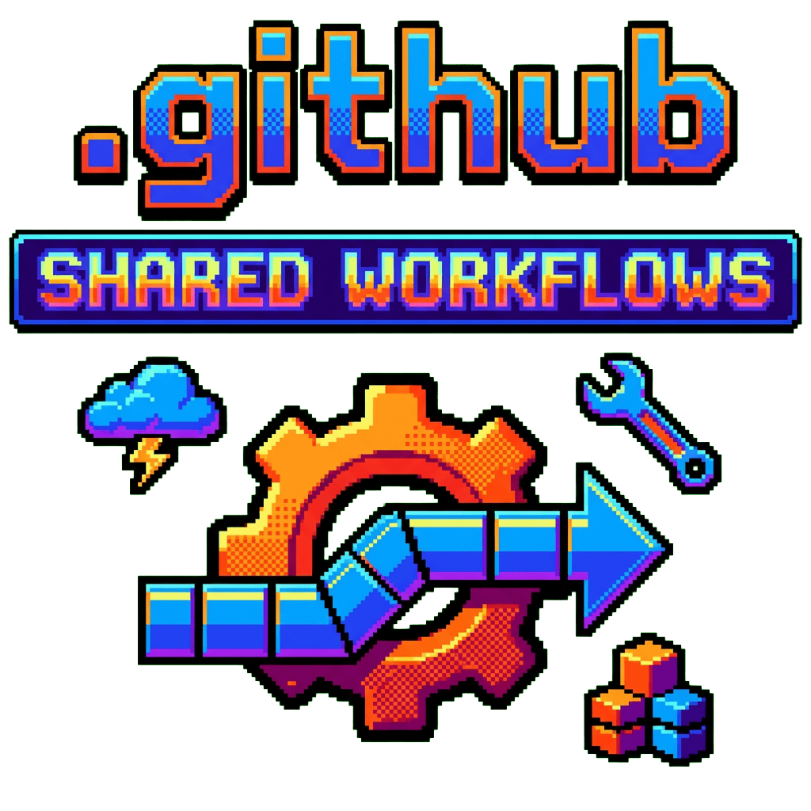

<p align="center">
  
  <br />
  <!-- repo-tagline:start -->
  <strong>🛠️ Shared reusable GitHub Actions workflows 🔧</strong>
  <!-- repo-tagline:end -->
</p>

Call these shared workflows from a repository's own GitHub Actions workflow.
They cover Python CI and release publishing, website audits, and approved
production delivery.

## Reusable workflows

| Workflow | Purpose |
|---|---|
| `ci.yml` | Callable Python CI interface for repositories with a uv project |
| `test.yml` | Install with uv and run pytest |
| `release.yml` | Compose testing with a GitHub release or PyPI publication |
| `publish-pypi.yml` | Build, release, and publish through PyPI trusted publishing |
| `create-release.yml` | Create a GitHub release without publishing a Python package |
| `sync-description.yml` | Validate the marked README tagline and sync the repository description |
| `production-delivery.yml` | Sync the approved caller’s Production secrets and deploy its exact CI-passing commit |
| `vercel-prebuilt.yml` | Build and stage an exact-commit Vercel artifact |
| `lighthouse-ci.yml` | Audit a live public page and publish representative Lighthouse scores |

The composite `check-version` action reads a static or Hatch-managed project version and reports whether its Git tag already exists.

## Usage

For example, add a release job to your caller workflow:

```yaml
jobs:
  release:
    uses: tsilva/.github/.github/workflows/release.yml@main
    secrets: inherit
```

Set `publish_to_pypi: false` under `with` for a GitHub-only release. Pin a
reviewed commit SHA when you need a reproducible caller.

- [Lighthouse audits](docs/caller-guide.md#lighthouse-ci)
- [Trusted production delivery](docs/caller-guide.md#trusted-production-delivery)
- [README tagline synchronization](docs/caller-guide.md#readme-tagline-syncing)

## License

[MIT License](LICENSE).
