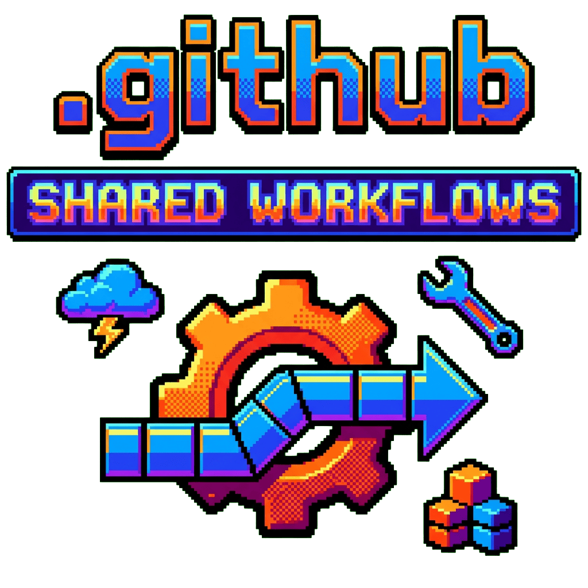

<p align="center">
  
  <br />
  <!-- repo-tagline:start -->
  <strong>🛠️ Shared reusable GitHub Actions workflows 🔧</strong>
  <!-- repo-tagline:end -->
</p>

## Reusable workflows

| Workflow | Purpose |
|---|---|
| `ci.yml` | Callable Python CI interface for repositories with a uv project |
| `test.yml` | Install with uv and run pytest |
| `release.yml` | Compose testing with a GitHub release or PyPI publication |
| `publish-pypi.yml` | Build, release, and publish through PyPI trusted publishing |
| `create-release.yml` | Create a GitHub release without publishing a Python package |
| `sync-description.yml` | Validate the marked README tagline and sync the repository description |
| `production-delivery.yml` | Sync the approved caller’s Production secrets and deploy its exact CI-passing commit |

The composite `check-version` action reads a static or Hatch-managed project version and reports whether its Git tag already exists.

## Usage

```yaml
jobs:
  release:
    uses: tsilva/.github/.github/workflows/release.yml@main
    secrets: inherit
```

For a non-Python release:

```yaml
jobs:
  release:
    uses: tsilva/.github/.github/workflows/release.yml@main
    with:
      publish_to_pypi: false
    secrets: inherit
```

Repository-fleet auditing is implemented in the separate private `private-maintain` project. This repository intentionally contains no audit engine, remediation CLI, bulk-administration scripts, or project-specific maintenance skills.

## Trusted production delivery

Approved app repositories call `production-delivery.yml` pinned to a reviewed full
commit SHA. There are no vault, destination or shell-command inputs. Immutable
GitHub repository IDs select the fixed allowlist in
[apps.json](.github/actions/production-delivery/apps.json). The privileged job
checks out only the shared implementation, waits for the caller's exact latest
main commit to pass `ci.yml`, fetches secrets directly from Infisical via OIDC,
syncs only Production variables, and verifies an exact-commit READY deployment.

Infisical requires the approved caller IDs, owner ID, main branch, Production
environment and **this reusable workflow at its pinned SHA**. App jobs cannot
obtain the shared reader directly. The reader still has access to all assigned
app vaults inside the trusted job; see the full
[trust contract and update procedure](.github/actions/production-delivery/README.md).
Do not inherit all caller secrets: pass only `VERCEL_TOKEN` and, for Chatex,
`CLOUDFLARE_API_TOKEN`. Keep app code and dependency installation outside the
trusted job. Chatex deploys its Worker code in a separate job without OIDC access.

A standalone Cloudflare relay handles signed Infisical notifications and starts
the fixed app entry workflow. It does not receive application secret values or
provide the Infisical reader. Relay credentials live in an isolated vault and
Cloudflare account, outside the application reader's access.

## README tagline syncing

The README is authoritative. Place exactly one marker pair around its visible tagline inside the opening `<p align="center">` block, after the logo:

Use HTML comment markers named `repo-tagline:start` and `repo-tagline:end`,
with the visible tagline between them. Keep the literal marker pair only once
in the document, including examples.

Use plain text inside `<strong>`, escaping characters such as `&` as `&amp;`. Extraction preserves emojis, decodes HTML entities, normalizes whitespace, and rejects empty, malformed, duplicate, or over-350-character taglines without updating metadata.

Add a caller such as `.github/workflows/sync-description.yml`, adjusting `main` to the repository's actual default branch:

```yaml
name: Sync README tagline
on:
  push:
    branches: [main]
    paths: [README.md, .github/workflows/sync-description.yml]
  pull_request:
    branches: [main]
    paths: [README.md, .github/workflows/sync-description.yml]
  workflow_dispatch:
permissions:
  contents: read
jobs:
  validate:
    if: github.event_name == 'pull_request'
    uses: tsilva/.github/.github/workflows/sync-description.yml@main
    with:
      validate-only: true
  sync:
    if: github.event_name != 'pull_request'
    uses: tsilva/.github/.github/workflows/sync-description.yml@main
    secrets:
      description-token: ${{ secrets.README_DESCRIPTION_TOKEN }}
```

The shared interface accepts `readme-path` (default `README.md`), `validate-only` (default `false`), and the optional `description-token` secret. Sync runs require that secret; validation runs do not. Store a fine-grained PAT or GitHub App token with Contents read and Administration write for the caller repository as `README_DESCRIPTION_TOKEN`. The default Actions token cannot update repository descriptions.

Public repositories can call this workflow only when this shared repository is public. Private callers can also call this public repository when their Actions policy allows it. Verify that the workflow is published and accessible before installing callers. Examples use the existing `@main` convention; callers can pin a verified shared-workflow commit SHA instead.

Pull requests validate their proposed README without metadata writes or an administration token. Pushes and manual runs can update descriptions only from the default branch, using its latest README. Missing credentials, malformed taglines, and API failures fail the run visibly. Unchanged descriptions are successful no-ops. Require the validation check in branch rules if it must block merges.

## License

[MIT License](LICENSE).
